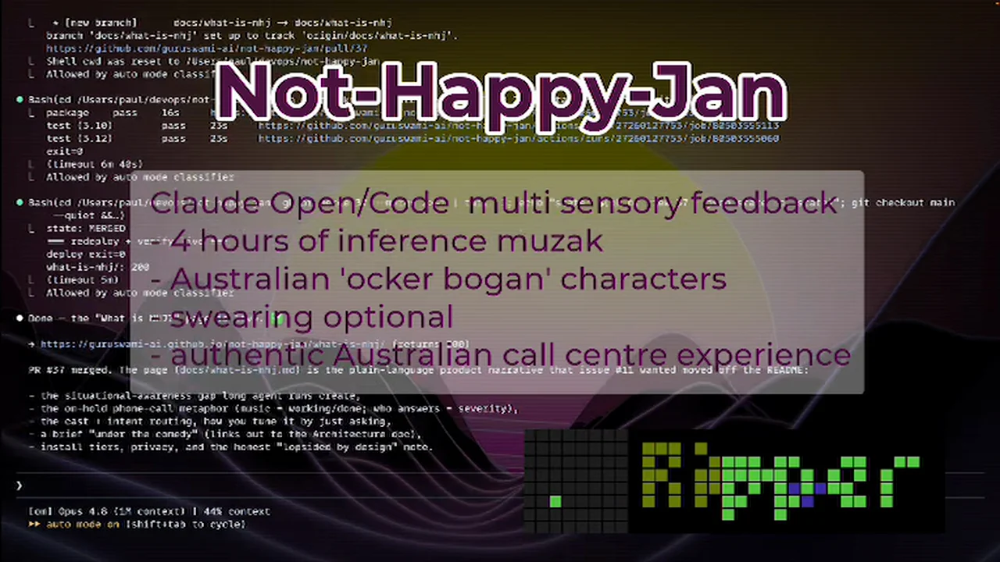
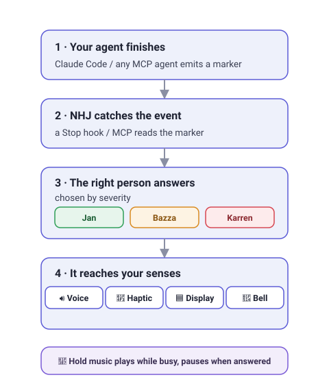

# Not-Happy-Jan

<p align="center">
  
</p>

**Multi-sensory feedback for AI coding agents: hold music while your agent works, then a local voice — cheerful on success, furious on failure — plus a buzz or flash on devices you already own.**

> *"Not happy, Jan — the issue is…"*

📖 **[Read the docs](https://guruswami-ai.github.io/not-happy-jan/)** · 🎬 **[Watch the demo](https://guruswami-ai.github.io/not-happy-jan/watch-the-demo/)** · 🚀 **[Quick start](docs/quickstart.md)**

<p align="center">
  <a href="https://guruswami-ai.github.io/not-happy-jan/watch-the-demo/">
    
  </a>
</p>

> ⚠️ **Public alpha** — early and for fun, with rough edges. [Open an issue](https://github.com/guruswami-ai/not-happy-jan/issues/new/choose) or [start a discussion](https://github.com/guruswami-ai/not-happy-jan/discussions).

## Install

```bash
curl -fsSL https://raw.githubusercontent.com/guruswami-ai/not-happy-jan/main/install.sh | bash
```

One non-interactive command, **no `sudo`**. Requirements: Python 3.10+, about 8 GB RAM (16 GB recommended) and, for the default profile, about 5 GB disk. The full live-voice experience runs on **Apple Silicon** or **Linux with an NVIDIA GPU**; the minimal profile speaks from the bundled voice bank on any supported Mac or Linux box.

| Profile | Use it when | Command |
|---|---|---|
| **Default** | Full cloned voices, dynamic lines and hold music, loaded on demand | `bash install.sh` |
| **Full** | You want warm local services for sub-second replies (macOS) | `bash install.sh --full` |
| **Minimal** | CI, low RAM, or no model downloads | `bash install.sh --minimal` |

→ Compare them in **[Requirements & tiers](docs/minimum-specs.md)** and **[Install profiles](docs/install-profiles.md)**. Linux or NVIDIA host? Start with the **[Linux guide](docs/linux.md)**. Nothing plays? The **[Quick start](docs/quickstart.md)** has the first checks (`nhj voices`, `nhj devices`, `nhj status`).

## 60-second quick start

```bash
nhj test ok                       # hear/feel/see a “done” on every configured channel
nhj voices                        # meet Jan, Bazza and Karren
nhj set jan.ockerism 11           # tune a character live — or just ask your agent
nhj mode rave                     # try a one-word mode; `nhj status` shows where you are
```

## What you'll experience

- 🎷 **Hold music while the agent works**, pausing when it finishes — a zero-attention working/done signal.
- 👩 **Jan** says “all done”, 🧑‍💼 **Bazza** escalates warnings, and 📣 **Karren** takes over when it breaks.
- 📟 **More than speakers:** alerts can fan out to a haptic mouse, pixel clocks, a LaMetric, a Vestaboard or a physical bell.
- 🧭 **Many agents, still legible:** alerts name the session, several coding CLIs are supported, and voice can be enabled per project.

<p align="center">
  
</p>

## Documentation

Start at the **[docs site](https://guruswami-ai.github.io/not-happy-jan/)**, or jump by intent:

- **New here:** [What is NHJ?](docs/what-is-nhj.md) · [Quick start](docs/quickstart.md) · [Watch the demo](docs/watch-the-demo.md)
- **Choosing or installing:** [Requirements & tiers](docs/minimum-specs.md) · [Install profiles](docs/install-profiles.md) · [Linux guide](docs/linux.md)
- **Living in it:** [Characters & dials](docs/characters.md) · [Modes](docs/modes.md) · [Audio & hold music](docs/AUDIO-STANDARD.md) · [Generative music](docs/generative-music.md)
- **Wiring agents and devices:** [Integration](docs/integration.md) · [Other agent CLIs](docs/other-clis.md) · [Multi-agent orchestration](docs/orchestration.md) · [Devices](docs/devices/README.md) · [AWTRIX display](docs/awtrix-display-setup.md) · [Haptic mouse](docs/haptic-mouse-setup.md)
- **Scripts and customising:** [`nhj run` for scripts & cron](docs/scripts.md) · [Dynamic voices](docs/dynamic-voices.md) · [Configuration](docs/configuration.md)
- **Building on it:** [Architecture](docs/ARCHITECTURE.md) · [Developer guide](docs/DEVELOPER-GUIDE.md) · [Contributing](CONTRIBUTING.md)

## Security & privacy

Inference runs **on your machine**; cloned-voice references do not leave it. Local services bind to `127.0.0.1` by default, LAN access is opt-in, a secret guard can scan prompts for leaked credentials, and install/uninstall are reversible user-only operations. See **[SECURITY.md](SECURITY.md)**.

## Credits & license

Built on the agent-feedback idea from **[AgentVibes](https://github.com/paulpreibisch/AgentVibes)** by Paul Preibisch — and taken way too far. Live voices use [Qwen3-TTS](https://huggingface.co/mlx-community/Qwen3-TTS-12Hz-0.6B-Base-8bit) via [mlx-audio](https://github.com/ml-explore/mlx-audio) on Apple Silicon, or [audio.cpp](https://github.com/0xshug0/audio.cpp) on Linux/NVIDIA.

Code is [MIT](LICENSE). Media and voice assets are licensed separately with mixed provenance; see **[Media provenance](docs/media-provenance.md)** and only use voice references you own or have documented consent to use.
